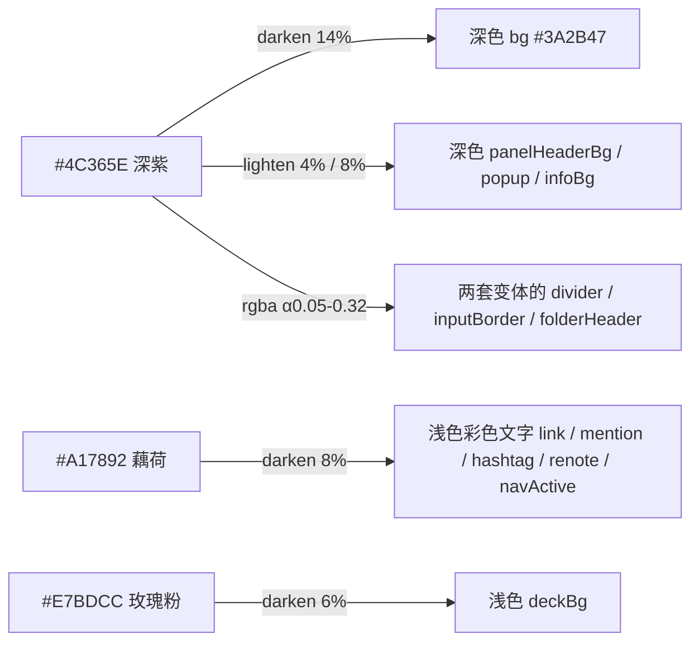

# March7th Bloom — Misskey 主题

用 7 色调色板做的 Misskey 主题，含浅色 / 深色两套，直接在「设置 → 主题 → 安装主题」里粘贴安装。

调色板：`#E7BDCC` `#FEF9FC` `#F7D7E3` `#DB9CB0` `#A17892` `#B3AAC9` `#4C365E`


- **浅色**：页面底色玫瑰粉、卡片浅粉、藕荷作强调色；近白只留给弹窗和按钮文字，避免大面积发白刺眼。
- **深色**：深紫面板 + 浅粉正文，亮玫瑰作强调色。

参考站点：<https://misskey.march7th.cn/>

## 安装

1. 设置 → 主题 → 安装主题（`/settings/theme/install`）。
2. 把 `themes/march7th-bloom-light.json5` 全文粘进 JSON5 代码框 → 点「预览」确认 → 点「安装」；深色同理装 `themes/march7th-bloom-dark.json5`。
3. 回到 设置 → 主题，把「浅色主题」「深色主题」分别选成这两套（Misskey 会跟随系统深浅色自动切换）。
4. 也可以把主题代码文本直接拖到「主题」页面上安装。站长可在实例控制台设置 `defaultLightTheme` / `defaultDarkTheme` 作为全站默认。

> **改配色后必须换 `id`**：Misskey 的 `addTheme()` 对已存在的 id 会抛 `already exists` 拒绝安装，`updateTheme()` 对同 id 直接跳过、不重新编译，所以沿用旧 id 的"新版本"会静默不生效。改完 id 后需要重新安装一次。

主题文件遵循官方格式 `{ id, name, author, desc, base, props, codeHighlighter }`：`props` 只写要覆写的键，其余自动继承 `_light.json5` / `_dark.json5` 基底（合并逻辑见官方 `frontend/src/theme.ts` 的 `applyTheme()`）。

## 调色板落点

| 色值 | 浅色 | 深色 |
| --- | --- | --- |
| `#E7BDCC` 玫瑰粉 | `bg` 页面背景、`panelHeaderBg` 面板标题栏、`panelHighlight` 悬停、`buttonBg` | `link`、`mentionMe` |
| `#FEF9FC` 近白 | `popup` 弹窗、`fgOnAccent` 按钮文字 | `infoFg` |
| `#F7D7E3` 浅粉 | `panel` 卡片/面板、`navBg`、`pageHeaderBg` | `fg` 正文 |
| `#DB9CB0` 亮玫瑰 | `love`、`navIndicator`、`buttonHoverBg` | `accent`、`buttonGradateA`、`love`、`fgHighlighted` |
| `#A17892` 藕荷 | `accent`、`fgOnWhite` | `folderHeaderBg` 引用块/文件夹底色 |
| `#B3AAC9` 雾紫 | `infoBg` | `hashtag`、`renote`、`navIndicator`、`buttonGradateB` |
| `#4C365E` 深紫 | `fg` 正文、`infoFg`、`buttonGradateB` | `panel` 面板底色、`fgOnAccent` |

调色板之外的派生值都是同色系的明度 / 透明度推移，不引入新色相：



深色 `bg` 是 `#4C365E` 加深一档（调色板里没有更深的颜色，否则正文和面板会糊在一起）。

## 仓库结构

| 路径 | 说明 |
| --- | --- |
| `themes/march7th-bloom-light.json5` | 浅色主题（`base: light`），39 个属性覆写 |
| `themes/march7th-bloom-dark.json5` | 深色主题（`base: dark`），39 个属性覆写 |
| `tools/check.mjs` | 校验 + 生成 `preview/theme-preview.html` |
| `tools/fetch-misskey-refs.mjs` | 拉取官方基底主题与 `theme.ts` 到 `vendor/`（不入库） |
| `tools/render.sh` | 用本地 Chromium 出预览图（可选） |
| `preview/shot.png` | README 里这张预览图 |

## 校验与预览

```bash
npm install
npm run refs     # 拉 misskey-dev/misskey 的 _light/_dark.json5 与 frontend-shared/js/theme.ts 到 vendor/
npm run check    # 校验并生成 preview/theme-preview.html
npm run render   # 可选：需要本地 Chromium，输出 preview/shot.png
```

`npm run check` 对每套主题逐项检查，并打印 WCAG 对比度表：

- JSON5 解析 + 官方 `validateTheme`（`id` / `name` / `base` / `props` 齐备）
- 属性名合法性：两套各 39 个键全部落在官方 62 个合法键内（`compile()` 会静默丢弃非法键，故必须预先比对）
- 官方 `compile()` 编译通过，62 个 `--MI_THEME-*` 变量全部产出、无缺失
- 回环校验：`JSON5.stringify` 导出再 `parseThemeCode` 导入后，62 个变量完全一致（模拟 Misskey 存储 / 导出 / 主题编辑器往返）
- 颜色值全部合法（`tinycolor.isValid()`；`panelBorder` 是 CSS 片段，属预期）
- `id` 唯一性：`themes/` 下两套主题互不冲突（同 id 会被 `addTheme()` 拒绝安装）

校验用的是 Misskey **官方实现**：`npm run refs` 拉下来的 `vendor/misskey-theme.ts` 是官方 `packages/frontend-shared/js/theme.ts` 的原样副本（只把 `@@/themes/_light.json5` 这个打包器别名换成运行时读文件），所以 `compile()` / `parseThemeCode()` 的行为与实例一致，不是本仓库重写的近似算法。官方源码以 AGPL-3.0 授权，不进本仓库。

## 实测对比度

浅色：

| 用途 | 前景 / 背景 | 对比度 |
| --- | --- | --- |
| 正文（面板上） | `#4C365E` / `#F7D7E3` | 7.91:1 ✅AA |
| 正文（页面背景上） | `#4C365E` / `#E7BDCC` | 6.29:1 ✅AA |
| 链接、提及、话题标签、转述、导航选中 | `rgb(142,99,126)` / `#F7D7E3` | 3.73:1 ⚠️AA- |
| 主按钮文字 | `#FEF9FC` / `#A17892` | 3.59:1 ⚠️AA- |
| 渐变按钮文字 | `#FEF9FC` / `#A17892`→`#4C365E` | 3.59→10.10:1 |
| 信息条文字 | `#4C365E` / `#B3AAC9` | 4.76:1 ✅AA |

深色：全部 ≥4.71:1 ✅AA（正文 7.91–9.76，链接 6.29，提及 4.71，话题标签/转述 4.76，主按钮 4.71，导航 7.91，信息条 7.67）。

浅色下 3.6–3.7:1 的几项是粉调色板的固有上限：面板是浅粉时，调色板里除 `#4C365E` 没有能过 4.5:1 的前景色（Misskey 官方浅色主题同项也只有 2.0–2.6:1）。想再提高见下面「可调项」。

## 可调项

| 想要的效果 | 改 `themes/march7th-bloom-light.json5` 里 | 怎么改 |
| --- | --- | --- |
| 更不刺眼（整屏更粉、白面全无） | `panel` / `bg` | `panel: '#E7BDCC'`、`bg: '#DB9CB0'` |
| 卡片更清爽、回一点亮度 | `panel` | `':lighten<2<#F7D7E3'` |
| 话题标签/转述恢复成玫瑰粉 | `hashtag` / `renote` / `mentionMe` | `'#DB9CB0'`（对比度会掉到 2.06:1） |
| 彩色文字再深一点 | `link` / `mention` / `hashtag` / `renote` / `navActive` / `fgHighlighted` | `':darken<14<@accent'` 之类（把数字调大） |
| 危险色跟调色板统一 | 新增 `error`（可一并加 `warn` / `success`） | 例如 `error: '#C2607A'`；不写则保持官方红黄绿 |

改完重跑 `npm run check` 就能看到新的对比度表。

## 已知取舍

- **深色 accent 用亮玫瑰 `#DB9CB0`，`fgOnAccent` 取深紫 `#4C365E`**：官方约定 `fgOnAccent` ≈ 白系，但白色在 `#DB9CB0` 上只有 2.1:1；取深紫后主按钮 / 渐变按钮 / 多选高亮全部 ≥4.71:1。已核对官方前端 25 处 `fgOnAccent` 用法，全部都在 accent 背景上，因此这个改动是安全的（唯一例外是 `MkButton` 的 danger 主按钮，它硬编码 `#fff`）。
- **浅色 accent 用 `#A17892` 而不是亮玫瑰**：accent 会被大量用作前景文字（按钮文字、选中态）。亮玫瑰作前景只有 2.15:1；藕荷是调色板里唯一能兼顾粉紫感与可读性的中间色。
- **浅色彩色文字统一为「accent 加深一档」**：`panel` 是浅粉时 `#A17892` 原色只有 2.83:1、亮玫瑰只有 1.67:1，所以链接 / 提及 / 话题标签 / 转述 / 导航选中统一取 `:darken<8<@accent`（3.73:1）。代价是话题标签不再单独呈玫瑰粉——官方深色主题与内置 `l-cherry` 同样是把这几项统一成 accent。
- **浅色 `#FEF9FC` 只出现在弹窗与按钮文字**：占屏面积最大的表面（timeline 面板、导航栏）全部落在粉色区，这是控制"发白刺眼"的关键。
- **危险色 `error` 保持官方红 `#ec4137`**：语义色不参与调色板改写，避免「危险」和品牌玫瑰混淆（见「可调项」）。
- **深色未使用 `#A17892` 作前景**：它在深紫面板上只有 3.3:1，故只用作引用块 / 文件夹的底色。
- 未改动 `success` / `warn` / `error` / `code*` / `scrollbarHandle*` / `modalBg` 等语义与中性键，它们继承基底主题；`badge`、`messageBg` 两个键在当前前端已无引用（代码搜索 0 命中），故未使用。

## 说明

- 主题文件本身只有颜色配置，随本仓库以 [MIT](LICENSE) 授权；`props` 键名遵循 [misskey-dev/misskey](https://github.com/misskey-dev/misskey)（AGPL-3.0）的主题 schema。
- 本主题由 Hermes Agent 生成，并用上述官方实现脚本校验后提交。
