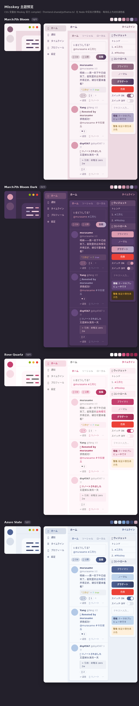
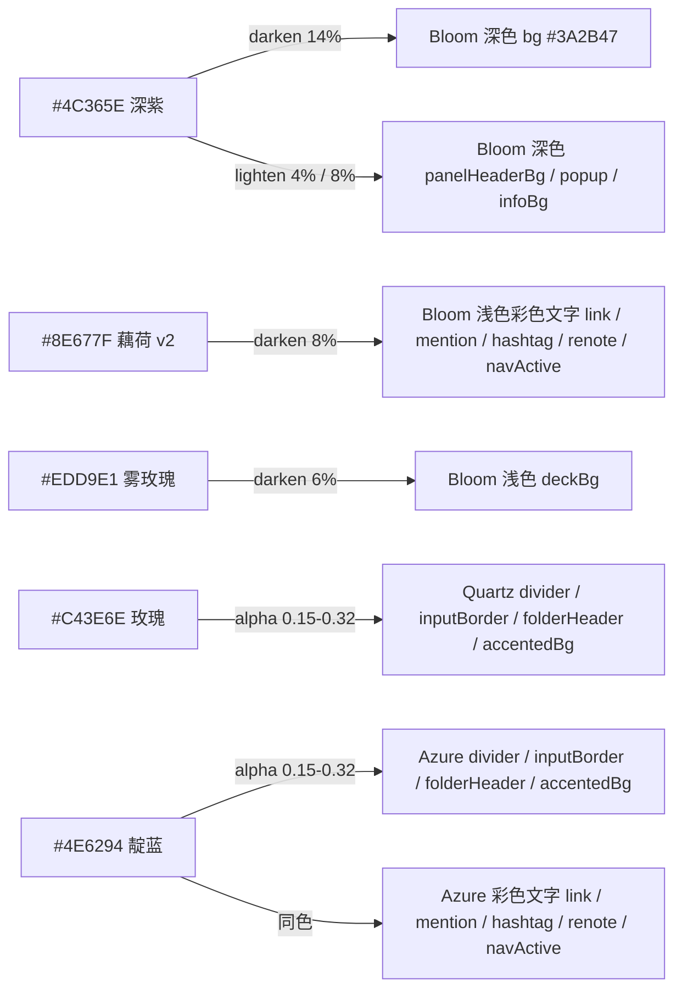

# Misskey 主题（March7th Bloom / Rose Quartz / Azure Slate）

基于给定调色板的 Misskey 主题，共四套：

- **March7th Bloom**（浅色 + 深色）：三月七粉紫配色
- **Rose Quartz**（浅色）：默认白底主题 + 玫瑰粉强调
- **Azure Slate**（浅色）：7 色蓝调配色

全部直接在「设置 → 主题 → 安装主题」里粘贴安装。

调色板：

- March7th Bloom：`#EDD9E1` `#FBF4F7` `#F3E4EA` `#DB9CB0` `#8E677F` `#B3AAC9` `#4C365E`（浅色为 v2 低饱和版；深色沿用原始调色板 `#E7BDCC` `#FEF9FC` `#F7D7E3` `#DB9CB0` `#A17892` `#B3AAC9` `#4C365E`）
- Rose Quartz：`#FFFFFF` `#FFF7FA` `#FBE4ED` `#DB5C88` `#C43E6E` `#8A2E4C` `#A02A52`
- Azure Slate：`#4E6294` `#EBF0F7` `#C2D7EE` `#7AA3D4` `#697EAE` `#343E65` `#CEABBC`



- **March7th Bloom 浅色（v2 低饱和）**：页面底退为雾玫瑰灰、卡片近白带粉调，粉色收缩到指示器 / 爱心 / 悬停等强调位；accent 加深一档修复按钮白字对比度。v1 大面积浅粉面板（`panel` 饱和度 67%）有反馈扎眼，v2 全面降饱和。
- **March7th Bloom 深色**：深紫面板 + 浅粉正文，亮玫瑰作强调色。
- **Rose Quartz**：保留官方默认主题的白底中性结构（白背景、灰正文），把强调色 / 链接 / 提及 / 话题标签 / 按钮渐变换成玫瑰粉，面板与按钮底加一层极浅米粉——「默认主题 + 粉色改动」。
- **Azure Slate**：雾蓝背景 + 近白卡片、深靛蓝正文（9:1）、靛蓝强调色，钢蓝导航指示 / 爱心，浅蓝信息条与按钮底，蓝色系贯穿。

参考站点：<https://misskey.march7th.cn/>

## 安装

1. 设置 → 主题 → 安装主题（`/settings/theme/install`）。
2. 把主题文件全文粘进 JSON5 代码框 → 点「预览」确认 → 点「安装」。四套文件都在 `themes/` 下：
   - `march7th-bloom-light.json5` / `march7th-bloom-dark.json5`（粉紫浅/深色）
   - `rose-quartz-light.json5`（白粉浅色）
   - `azure-slate-light.json5`（蓝色浅色）
3. 回到 设置 → 主题，把「浅色主题」「深色主题」分别选成想要的套（Misskey 会跟随系统深浅色自动切换；目前深色只有 March7th Bloom 一套，其余主题装浅色即可）。
4. 也可以把主题代码文本直接拖到「主题」页面上安装。站长可在实例控制台设置 `defaultLightTheme` / `defaultDarkTheme` 作为全站默认。

> **改配色后必须换 `id`**：Misskey 的 `addTheme()` 对已存在的 id 会抛 `already exists` 拒绝安装，`updateTheme()` 对同 id 直接跳过、不重新编译，所以沿用旧 id 的"新版本"会静默不生效。改完 id 后需要重新安装一次。

主题文件遵循官方格式 `{ id, name, author, desc, base, props, codeHighlighter }`：`props` 只写要覆写的键，其余自动继承 `_light.json5` / `_dark.json5` 基底（合并逻辑见官方 `frontend/src/theme.ts` 的 `applyTheme()`）。

## 调色板落点

### March7th Bloom（粉紫）

| 色值 | 浅色（v2） | 深色 |
| --- | --- | --- |
| `#EDD9E1` 雾玫瑰 | `bg` 页面背景 | —（原始玫瑰粉 `#E7BDCC` 在深色作 `link`、`mentionMe`） |
| `#FBF4F7` 月白粉 | `panel` 卡片/面板、`navBg`、`pageHeaderBg` | —（原始浅粉 `#F7D7E3` 在深色作 `fg` 正文） |
| `#F3E4EA` 浅米粉 | `panelHeaderBg` 面板标题栏、`panelHighlight` 悬停、`buttonBg` | — |
| `#FEF9FC` 近白 | `popup` 弹窗、`fgOnAccent` 按钮文字 | `infoFg` |
| `#DB9CB0` 亮玫瑰 | `love`、`navIndicator`、`buttonHoverBg` | `accent`、`buttonGradateA`、`love`、`fgHighlighted` |
| `#8E677F` 藕荷（v2 加深） | `accent`、`fgOnWhite` | —（原始藕荷 `#A17892` 在深色作 `folderHeaderBg` 引用块/文件夹底色） |
| `#B3AAC9` 雾紫 | `infoBg` | `hashtag`、`renote`、`navIndicator`、`buttonGradateB` |
| `#4C365E` 深紫 | `fg` 正文、`infoFg`、`buttonGradateB` | `panel` 面板底色、`fgOnAccent` |

### Rose Quartz（白粉）

白底结构沿用官方默认主题，调色板负责「粉色改动」部分：

| 色值 | 用途 |
| --- | --- |
| `#FFFFFF` 白 | `bg` / `panelHeaderBg` / `pageHeaderBg` / `popup` / `fgOnAccent` |
| `#FFF7FA` 米粉 | `panel` 卡片/面板、`navBg` |
| `#FBE4ED` 浅粉 | `buttonBg`、`infoBg`、`panelHighlight` |
| `#DB5C88` 亮玫瑰 | `navIndicator`、`love` |
| `#C43E6E` 玫瑰 | `accent` / `link` / `mention` / `hashtag` / `buttonGradateA` / `navActive` |
| `#8A2E4C` 深玫 | `infoFg` |
| `#A02A52` 酒红 | `renote`、`buttonGradateB` |

### Azure Slate（蓝）

| 色值 | 用途 |
| --- | --- |
| `#4E6294` 靛蓝 | `accent` / `link` / `mention` / `hashtag` / `renote` / `navActive` / `buttonGradateA` |
| `#EBF0F7` 雾蓝 | `bg`、`pageHeaderBg`、`panelHeaderBg` |
| `#C2D7EE` 浅蓝 | `infoBg`、`buttonBg` |
| `#7AA3D4` 中蓝 | `navIndicator`、`love` |
| `#697EAE` 钢蓝 | （调色板成员；文字角色改取 accent `#4E6294` 以保证 AA） |
| `#343E65` 深靛蓝 | `fg` 正文、`infoFg`、`buttonGradateB` |
| `#CEABBC` 藕灰粉 | （调色板成员，暖调点缀；未作承载面） |

调色板之外的派生值都是同色系的明度 / 透明度推移，不引入新色相：



Bloom 深色 `bg` 是 `#4C365E` 加深一档（调色板里没有更深的颜色，否则正文和面板会糊在一起）。

## 仓库结构

| 路径 | 说明 |
| --- | --- |
| `themes/march7th-bloom-light.json5` | March7th Bloom 浅色（`base: light`），39 个属性覆写 |
| `themes/march7th-bloom-dark.json5` | March7th Bloom 深色（`base: dark`），39 个属性覆写 |
| `themes/rose-quartz-light.json5` | Rose Quartz 白粉浅色（`base: light`），39 个属性覆写 |
| `themes/azure-slate-light.json5` | Azure Slate 蓝色浅色（`base: light`），39 个属性覆写 |
| `tools/check.mjs` | 校验全部 4 套 + 生成 `preview/theme-preview.html` |
| `tools/fetch-misskey-refs.mjs` | 拉取官方基底主题与 `theme.ts` 到 `vendor/`（不入库） |
| `tools/render.sh` | 用本地 Chromium 出预览图（可选） |
| `preview/shot.png` | README 里这张预览图（四套纵排） |

## 校验与预览

```bash
npm install
npm run refs     # 拉 misskey-dev/misskey 的 _light/_dark.json5 与 frontend-shared/js/theme.ts 到 vendor/
npm run check    # 校验并生成 preview/theme-preview.html
npm run render   # 可选：需要本地 Chromium，输出 preview/shot.png
```

`npm run check` 对每套主题（4 套）逐项检查，并打印 WCAG 对比度表：

- JSON5 解析 + 官方 `validateTheme`（`id` / `name` / `base` / `props` 齐备）
- 属性名合法性：每套 39 个键全部落在官方 62 个合法键内（`compile()` 会静默丢弃非法键，故必须预先比对）
- 官方 `compile()` 编译通过，62 个 `--MI_THEME-*` 变量全部产出、无缺失
- 回环校验：`JSON5.stringify` 导出再 `parseThemeCode` 导入后，62 个变量完全一致（模拟 Misskey 存储 / 导出 / 主题编辑器往返）
- 颜色值全部合法（`tinycolor.isValid()`；`panelBorder` 是 CSS 片段，属预期）
- `id` 唯一性：`themes/` 下四套主题互不冲突（同 id 会被 `addTheme()` 拒绝安装）

校验用的是 Misskey **官方实现**：`npm run refs` 拉下来的 `vendor/misskey-theme.ts` 是官方 `packages/frontend-shared/js/theme.ts` 的原样副本（只把 `@@/themes/_light.json5` 这个打包器别名换成运行时读文件），所以 `compile()` / `parseThemeCode()` 的行为与实例一致，不是本仓库重写的近似算法。官方源码以 AGPL-3.0 授权，不进本仓库。

## 实测对比度

浅色（v2）：

| 用途 | 前景 / 背景 | 对比度 |
| --- | --- | --- |
| 正文（面板上） | `#4C365E` / `#FBF4F7` | 9.71:1 ✅AA |
| 正文（页面背景上） | `#4C365E` / `#EDD9E1` | 7.82:1 ✅AA |
| 链接、提及、话题标签、转述、导航选中 | `rgb(118,86,106)` / `#FBF4F7` | 5.86:1 ✅AA |
| 主按钮文字 | `#FEF9FC` / `#8E677F` | 4.59:1 ✅AA |
| 渐变按钮文字 | `#FEF9FC` / `#8E677F`→`#4C365E` | 4.59→10.10:1 |
| 普通按钮文字 | `#4C365E` / `#F3E4EA` | 8.56:1 ✅AA |
| 信息条文字 | `#4C365E` / `#B3AAC9` | 4.76:1 ✅AA |

v1 里 3.59–3.73:1（AA-）的三项——彩色文字、主按钮白字——在 v2 全部拉过 AA。

深色：全部 ≥4.71:1 ✅AA（正文 7.91–9.76，链接 6.29，提及 4.71，话题标签/转述 4.76，主按钮 4.71，导航 7.91，信息条 7.67）。

Rose Quartz（白粉）：全部 ≥4.68:1 ✅AA

| 用途 | 前景 / 背景 | 对比度 |
| --- | --- | --- |
| 正文（面板上） | `#5F5F5F` / `#FFF7FA` | 6.06:1 ✅AA |
| 正文（页面背景上） | `#5F5F5F` / `#FFFFFF` | 6.39:1 ✅AA |
| 链接、提及、话题标签、导航选中 | `#C43E6E` / `#FFF7FA` | 4.68:1 ✅AA |
| 转述 | `#A02A52` / `#FFF7FA` | 6.76:1 ✅AA |
| 主按钮文字 | `#FFFFFF` / `#C43E6E` | 4.93:1 ✅AA |
| 渐变按钮文字 | `#FFFFFF` / `#C43E6E`→`#A02A52` | 4.93→7.12:1 |
| 信息条文字 | `#8A2E4C` / `#FBE4ED` | 6.76:1 ✅AA |

Azure Slate（蓝）：全部 ≥5.73:1 ✅AA

| 用途 | 前景 / 背景 | 对比度 |
| --- | --- | --- |
| 正文（面板上） | `#343E65` / `#F7FAFD` | 9.91:1 ✅AA |
| 正文（页面背景上） | `#343E65` / `#EBF0F7` | 9.07:1 ✅AA |
| 链接、提及、话题标签、转述、导航选中 | `#4E6294` / `#F7FAFD` | 5.73:1 ✅AA |
| 主按钮文字 | `#FFFFFF` / `#4E6294` | 6.00:1 ✅AA |
| 渐变按钮文字 | `#FFFFFF` / `#4E6294`→`#343E65` | 6.00→10.38:1 |
| 信息条文字 | `#343E65` / `#C2D7EE` | 7.04:1 ✅AA |

March7th Bloom v1 里 3.6–3.7:1 的几项是 v1 浅粉面板的固有上限：面板本身饱和度 67% 时，调色板里除 `#4C365E` 没有能过 4.5:1 的前景色。v2 把面板降饱和提明度后，同一批前景色自然过 AA，不需要再靠「加深到接近正文色」换可读性。Rose Quartz 与 Azure Slate 的彩色文字取 accent 原色，白 / 近白面板上直接过 AA，无需加深。

## 可调项

| 想要的效果 | 改 `themes/march7th-bloom-light.json5` 里 | 怎么改 |
| --- | --- | --- |
| 回到 v1 的高饱和粉（扎眼但更浓） | `panel` / `bg` | `panel: '#F7D7E3'`、`bg: '#E7BDCC'`、`accent: '#A17892'`（v1 原值；彩色文字会掉回约 3.7:1） |
| 整屏再粉一档（介于 v1/v2 之间） | `panel` / `bg` | `panel: '#F9EDF2'`、`bg: '#F0DCE4'`（panel S≈55%，文字仍过 AA） |
| 话题标签/转述恢复成玫瑰粉 | `hashtag` / `renote` / `mentionMe` | `'#DB9CB0'`（对比度会掉到约 2.1:1） |
| 彩色文字再深一点 | `link` / `mention` / `hashtag` / `renote` / `navActive` / `fgHighlighted` | `':darken<15<@accent'` 之类（把数字调大） |
| 危险色跟调色板统一 | 新增 `error`（可一并加 `warn` / `success`） | 例如 `error: '#C2607A'`；不写则保持官方红黄绿 |

Rose Quartz / Azure Slate 可调项：

| 想要的效果 | 改哪个文件里 | 怎么改 |
| --- | --- | --- |
| 白粉面板更白（完全回到默认白） | `rose-quartz-light.json5` 的 `panel` / `navBg` | `panel: '#FFFFFF'` |
| 白粉更浓 | `rose-quartz-light.json5` 的 `panel` / `buttonBg` | `panel: '#FBE4ED'`、`buttonBg: '#F3CFDD'` |
| 蓝色正文更柔和 | `azure-slate-light.json5` 的 `fg` | `'#4E6294'`（面板上 5.73:1，仍过 AA） |
| 蓝色面板更蓝 | `azure-slate-light.json5` 的 `panel` | `':lighten<6<#EBF0F7'` 或直接 `'#EBF0F7'`（与 bg 同色，层次会变弱） |
| 转述/提及恢复中蓝 | `azure-slate-light.json5` 的 `renote` / `mentionMe` | `'#697EAE'`（对比度会掉到 3.86:1） |

改完重跑 `npm run check` 就能看到新的对比度表。

## 已知取舍

- **深色 accent 用亮玫瑰 `#DB9CB0`，`fgOnAccent` 取深紫 `#4C365E`**：官方约定 `fgOnAccent` ≈ 白系，但白色在 `#DB9CB0` 上只有 2.1:1；取深紫后主按钮 / 渐变按钮 / 多选高亮全部 ≥4.71:1。已核对官方前端 25 处 `fgOnAccent` 用法，全部都在 accent 背景上，因此这个改动是安全的（唯一例外是 `MkButton` 的 danger 主按钮，它硬编码 `#fff`）。
- **浅色 accent v2 用加深的 `#8E677F`**：accent 会被大量用作前景与按钮承载色。v1 的 `#A17892` 上近白按钮文字只有 3.59:1（AA-）；v2 把 accent 加深一档到 `#8E677F`（色相不变），白字 4.59:1 过 AA。
- **浅色彩色文字统一为「accent 加深一档」**：链接 / 提及 / 话题标签 / 转述 / 导航选中统一取 `:darken<8<@accent`（v2 面板上 5.86:1）。代价是话题标签不单独呈玫瑰粉——官方深色主题与内置 `l-cherry` 同样是把这几项统一成 accent。
- **v1 教训：占屏面积决定刺眼程度**：v1 让 timeline 面板 / 导航栏 / 页头全部落在高饱和粉（`#F7D7E3`，S=67%）上以"避免大面积发白"，结果用户反馈扎眼——浅色主题里大面积承载面应近中性，彩色留给指示器 / 爱心 / 悬停等小面积强调位。
- **危险色 `error` 保持官方红 `#ec4137`**：语义色不参与调色板改写，避免「危险」和品牌玫瑰混淆（见「可调项」）。
- **深色未使用 `#A17892` 作前景**：它在深紫面板上只有 3.3:1，故只用作引用块 / 文件夹的底色。
- **Rose Quartz 的彩色文字取 accent 原色 `#C43E6E`**：面板是近白时不需要像 Bloom 那样加深，`#C43E6E` 在 `#FFF7FA` 上 4.68:1 直接过 AA；转述取更深的酒红 `#A02A52`（6.76:1）作区分。
- **Azure Slate 的文字角色统一取靛蓝 `#4E6294`**：调色板里的钢蓝 `#697EAE` 在近白面板上只有 3.86:1（AA-），故 `link` / `mention` / `hashtag` / `renote` / `mentionMe` / `navActive` 全部取 `#4E6294`（5.73:1）；`#697EAE` 保留在调色板里但不作文字角色。
- **Rose Quartz 正文保持默认灰 `#5F5F5F`**：「默认主题 + 粉色改动」只改强调面，正文换深色会降低默认主题的熟悉感；中性灰在白底上 6.39:1。
- 未改动 `success` / `warn` / `error` / `code*` / `scrollbarHandle*` / `modalBg` 等语义与中性键，它们继承基底主题；`badge`、`messageBg` 两个键在当前前端已无引用（代码搜索 0 命中），故未使用。

## 说明

- 主题文件本身只有颜色配置，随本仓库以 [MIT](LICENSE) 授权；`props` 键名遵循 [misskey-dev/misskey](https://github.com/misskey-dev/misskey)（AGPL-3.0）的主题 schema。
- 本主题由 Hermes Agent 生成，并用上述官方实现脚本校验后提交。
